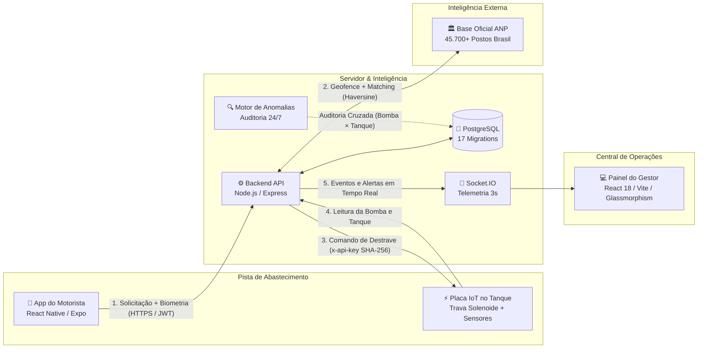

# EHR Solutions — Plataforma Inteligente de Gestão de Frotas e Segurança de Abastecimento IoT

<div align="center">


-success?style=for-the-badge&logo=jest)


**Plataforma de alta precisão para controle de abastecimento, telemetria em tempo real, validação biométrica facial e erradicação de desvios de combustível em frotas pesadas.**

[Arquitetura do Sistema](docs/ARQUITETURA.md) • [Guia de Integração de Hardware](docs/GUIA_INTEGRACAO_HARDWARE.md) • [Roteiro de Demonstração](docs/ROTEIRO_APRESENTACAO.md) • [API Mobile](docs/API_MOBILE.md)

</div>

---

## 📌 1. Visão Geral do Projeto

No setor de logística e transporte rodoviário, fraudes e desvios de combustível representam até **20% dos custos operacionais** de uma transportadora. As perdas decorrem de:
* **Litros fantasmas:** Divergência entre os litros cobrados na bomba e o que realmente entra no tanque.
* **Abastecimento fora de rota:** Paradas em postos clandestinos ou descredenciados.
* **Uso indevido de cartões:** Cartões de combustível corporativos utilizados para abastecer terceiros ou veículos não autorizados.

O **EHR Solutions** resolve esse desafio conectando **três pontas simultâneas** em tempo real:
1. **O Motorista:** Faz a solicitação pelo app mobile nativo com validação biométrica facial antes de qualquer gota ser liberada.
2. **A Placa IoT no Caminhão:** Uma trava solenoide instalada no bocal do tanque permanece trancada e **só destrava por ordem remota criptografada do servidor (`unlock: true`)**.
3. **O Painel Web do Gestor:** Interface de monitoramento em tempo real (Next-Gen IoT) com telemetria via WebSocket, conciliação com a base de **45.700+ postos da ANP** e motor forense de detecção de anomalias.

---

## 🏗️ 2. Arquitetura dos Componentes



---

## 🚀 3. Principais Pilares de Inovação e Segurança

### 👤 A. Biometria Facial Nativa e Prova de Identidade
* Captura facial guiada com máscara oval diretamente pela câmera do smartphone.
* Compressão e redimensionamento nativos em menos de **100ms** gerando payload JPEG menor que **200KB**.
* Comparação biométrica contra a foto oficial de cadastro no RH. Se o rosto não for reconhecido ou o motorista não estiver cadastrado, a operação é bloqueada com `409 face_not_enrolled`.

### 🔐 B. Provisionamento Seguro de Chaves IoT (`x-api-key`)
* Comunicação segura entre a placa de cada caminhão e a API.
* **Armazenamento Irreversível:** As chaves de hardware **nunca são salvas em texto puro**. Um trigger no PostgreSQL gera o hash criptográfico **SHA-256** imediatamente.
* **Segurança contra Força Bruta:** Rate-limiting dedicado por dispositivo e por IP, registrando auditoria (`last_used_at`) a cada requisição válida.
* O painel web exibe a chave apenas **uma única vez** com snippets prontos para `PowerShell` e `curl` para a equipe técnica de bancada.

### 🏛️ C. Inteligência Regulatória da ANP (45.700+ Postos)
* Banco de dados local sincronizado diretamente com a base oficial de revendedores da **Agência Nacional do Petróleo (ANP)**.
* **Geofencing Haversine:** Ao iniciar o abastecimento, o sistema calcula a distância matemática exata. Se o caminhão estiver fora de um posto homologado, o destrave é vetado e um evento de tentativa não autorizada é gravado.
* **Bloqueio por Adulteração:** Postos interditados pela ANP (`interdicted = true`) por combustível fora do padrão ou bomba fraudada são bloqueados automaticamente.

### 🚨 D. Motor de Detecção de Anomalias (Auditoria Forense)
* O motor de regras roda 24/7 avaliando cada ciclo de abastecimento:
  * **Divergência Bomba × Tanque:** Alerta imediato se o volume cobrado pela bomba for superior ao volume real detectado pelos sensores do tanque.
  * **Abastecimento Fora de Posto Credenciado:** Identificação de paradas suspeitas em galões ou locais não homologados.
  * **Divergência de Posição:** Alerta se a coordenada do motorista (app) diferir da posição do caminhão (hardware).

### ⚖️ E. Compliance com a LGPD
* **Zero Imagens em Disco:** Imagens de reconhecimento facial são processadas em memória e nunca salvas em disco.
* **Descarte Automático:** Metadados de auditoria biométrica possuem expiração programada (`retentionService`).
* **Mascaramento:** CPF, dados pessoais e senhas trafegam e são exibidos com ofuscação parcial.

### 💳 F. Carteira Digital de Frota (Open Banking & Gestão de Cartões)
* Controle financeiro de abastecimentos em tempo real para os motoristas.
* **Integração Open Banking:** Preparado para conciliação bancária via APIs públicas de instituições financeiras (ex.: Sicoob).
* **Cadastro e Gestão de Cartões:** Motoristas e gestores podem cadastrar, definir cartão padrão e controlar limites operacionais diretamente pelo app.

### 📱 G. Biometria Nativa do Smartphone (Touch ID / Face ID)
* Desbloqueio e autenticação rápida no aplicativo utilizando os sensores biométricos de hardware do celular (via `expo-local-authentication`).
* Complementa a validação facial de liberação da bomba com uma camada adicional de segurança física no dispositivo.

---

## 🧪 4. Cobertura de Testes e Qualidade (548 Testes Automatizados)

O projeto conta com **100% de testes automatizados passando com sucesso** em todas as camadas da aplicação:

| Módulo | Ferramenta | Escopo dos Testes | Status |
|---|---|---|---|
| **Backend API** | Jest | Contrato de API, Autenticação, RBAC, Criptografia SHA-256, Geofencing, Detecção de Anomalias, ANP Sync, Carteira e Hardware | ✅ **312 passed** (28 suítes) |
| **Frontend Web** | Vitest + Testing Library | Painel, Rotas, Modais protegidos, Detalhes do Caminhão, Mapas Leaflet, Máscaras e Tabela ANP | ✅ **58 passed** (13 suítes) |
| **Mobile App** | Jest + React Native Testing | Fluxo da Câmera Facial, SecureStore, Máquina de Estados, Fallback BLE, Carteira Sicoob e Biometria Nativa | ✅ **178 passed** (13 suítes) |
| **Frontend Lint** | ESLint | Análise estática de código e integridade de tipos | ✅ **0 erros / 0 avisos** |
| **Total Global** | — | **Varredura completa de ponta a ponta** | 🏆 **548 / 548 (100% GREEN)** |

---

## 💻 5. Como Executar o Projeto Localmente

### Pré-requisitos
* **Node.js** (v18 ou superior)
* **PostgreSQL** (v14+) ou Docker

### 1. Banco de Dados
Inicie o banco PostgreSQL localmente ou via Docker Compose:
```bash
docker-compose up -d
```

### 2. Backend API
```bash
cd backend
npm install
npm run dev
```
* O backend roda em `http://localhost:3001`.
* As migrations (001 a 016) e triggers são executados automaticamente na inicialização.

### 3. Painel Web do Gestor
```bash
cd frontend
npm install
npm run dev
```
* O painel web estará acessível em `http://localhost:5173`.
* Acesse com as credenciais do administrador. Em produção, execute `npm run create-admin` no backend para criar o primeiro gestor (senha mínima de 12 caracteres informada via variável de ambiente `ADMIN_PASSWORD` ou em prompt interativo sem eco; utilize `--reset` para redefinição de senha sem alterar o papel; o argumento `--password` é descontinuado por segurança). O seed (`npm run seed`) é exclusivo para desenvolvimento (somente desenvolvimento, exige ALLOW_SEED_WIPE=true e NODE_ENV != production).

### 4. Aplicativo Mobile do Motorista
```bash
cd mobile
npm install
npx expo start
```
* Abra o app no **Expo Go** (Android/iOS) lendo o QR code ou abrindo no emulador.
* Utilize as credenciais do motorista previamente cadastrado pelo gestor no painel administrativo.

---

## 📁 6. Estrutura do Repositório e Documentação Técnica

```text
EHR-Solutions-Web/
├── backend/          # API REST Node.js, Express, PostgreSQL, Socket.IO e Anomaly Engine
│   ├── src/
│   │   ├── config/          # Conexão com banco e migrations versionadas (001 a 016)
│   │   ├── controllers/     # Controladores (Auth, Drivers, Fleet, Fueling, Stations, Reports)
│   │   ├── middleware/      # JWT, Hardware Auth (SHA-256), Rate Limiter, RBAC
│   │   ├── routes/          # Definição das rotas REST da plataforma
│   │   └── services/        # Motor de Anomalias, ANP Sync, Haversine Matcher e Virtual Hardware
│   └── tests/               # 20 suítes de testes automatizados Jest (265 testes)
│
├── frontend/         # Painel Web do Gestor (React 18 + Vite + Leaflet + Glassmorphism)
│   ├── src/
│   │   ├── components/      # Modais de Motorista, Cartão de Hardware Key, Mapas, TopBar, Sidebar
│   │   ├── pages/           # Dashboard, Frota, Motoristas, Postos ANP, Investigação, Relatórios
│   │   └── store/           # Gerenciamento de estado com Zustand e WebSocket em tempo real
│   └── tests/               # 10 suítes de testes Vitest (45 testes)
│
├── mobile/           # Aplicativo do Motorista (React Native + Expo)
│   ├── src/
│   │   ├── contexts/        # Contexto de autenticação e sessão com SecureStore
│   │   └── screens/         # Login, Câmera Facial Biométrica, Status da Trava e Histórico
│   └── tests/               # 11 suítes de testes Jest (150 testes)
│
├── docs/             # Manuais Oficiais e Documentação Executiva
│   ├── ARQUITETURA.md                 # Arquitetura detalhada, fluxos e tabelas
│   ├── GUIA_INTEGRACAO_HARDWARE.md    # Manual técnico para a equipe de hardware embarcado
│   ├── ROTEIRO_APRESENTACAO.md        # Roteiro cronometrado passo a passo para a banca avaliadora
│   └── API_MOBILE.md                  # Especificação dos contratos da API Mobile
│
└── .github/workflows # CI/CD automatizado no GitHub Actions (backend, frontend e mobile)
```

---

## 🏆 7. Diferenciais Técnicos e Prontidão para o Hardware

1. **Hardware Virtual e Simulador Embutido:** O sistema possui um módulo completo de hardware virtual (`virtualHardware.js`) e simulador de telemetria rodoviária (`simulator.js`). Toda a plataforma pode ser operada e testada de ponta a ponta sem necessidade imediata da placa física conectada.
2. **Integração Plug-and-Play:** A documentação completa de contratos de API, payloads de telemetria e especificações elétricas/lógicas da trava solenoide está consolidada em [`docs/GUIA_INTEGRACAO_HARDWARE.md`](docs/GUIA_INTEGRACAO_HARDWARE.md).
3. **Branch Protection & CI:** A branch `main` é protegida e exige passagem integral de todos os 460 testes para qualquer merge.

---

<div align="center">
  <sub>Desenvolvido com foco em excelência técnica, segurança e inovação para o ecossistema de transporte de cargas.</sub>
</div>
