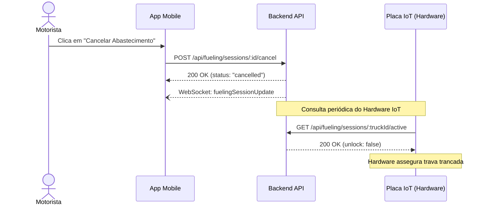

Verificado contra o commit 1f2d061eb98f92bcb61e834a0827fa3598d816a8

# EHR Solutions - Documentação da API Mobile & Hardware

Este documento especifica as rotas expostas para o App Mobile (Motorista) e a comunicação com a Placa IoT (Hardware).

## Integração via Socket.IO
- `emergencyUnlockRequest`: Emitido quando o motorista atinge o máximo de falhas faciais e precisa da ajuda do gestor (payload: sessão completa).
- `newAlert`: Disparado como broadcast global para todos os clientes sempre que surge um alerta no sistema.
- `fuelingSessionUpdate`: Emitido em tempo real sempre que há atualização no status de uma sessão (autorizada, em andamento, cancelada ou concluída).

---

## 1. Login do Motorista

### `POST /api/auth/driver/login`
Autentica o motorista, devolvendo o token JWT e dados do caminhão atualmente vinculado (se houver).

**Requisição (Body):**
```json
{
  "email": "motorista@ehr.com",
  "password": "senha"
}
```

**Respostas:**
- **200 OK**: Retorna o JWT de 30d, motorista e veículo logado.
- **401 Unauthorized**: `{ "error": "Credenciais inválidas" }`

---

## 2. Fluxo de Abastecimento (Motorista e Gestor)

### `POST /api/fueling/sessions`
Inicia um processo de abastecimento. Protegido por `managerOrDriver`.

**Autenticação e Erros (401/403/400):**
- **401 Unauthorized**: `{ "error": "Authorization token missing or invalid" }`
- **401 Unauthorized**: `{ "error": "Invalid or expired token" }`
- **401 Unauthorized**: `{ "error": "User not found" }`
- **401 Unauthorized**: `{ "error": "User is deactivated" }`
- **403 Forbidden**: `{ "error": "driver_inactive" }`
- **403 Forbidden**: `{ "error": "forbidden_role" }`

**Respostas da Rota:**
- **201 Created**: Devolve a sessão criada.
- **400 Bad Request**: `{ "error": "truck_id é obrigatório" }`
- **400 Bad Request**: `{ "error": "invalid_release_method" }`
- **403 Forbidden**: `{ "error": "Este caminhão não está vinculado a você" }`
- **404 Not Found**: `{ "error": "Caminhão não encontrado" }`
- **409 Conflict**: `{ "error": "Já existe uma sessão ativa para este caminhão" }`

---

### `POST /api/fueling/sessions/:id/cancel`
Cancela uma sessão de abastecimento solicitada ou autorizada. Protegido por `managerOrDriver` (motorista dono da sessão ou gestor; hardware não pode cancelar).

**Quem chama:** App Mobile (Motorista) ou Painel Web (Gestor).
**Corpo da requisição:** Vazio (`{}`).

**Regras e Comportamento:**
- Operação atômica no banco de dados para sessões em status `requested` ou `authorized`.
- Libera o caminhão associado de volta para o estado `idle` (sem alterar o status de saúde da frota).
- Idempotência: caso a sessão já tenha sido cancelada anteriormente pelo próprio usuário, responde **200 OK** `{ "success": true, "status": "cancelled" }`.
- O hardware que consultar `GET /api/fueling/sessions/:truckId/active` após o cancelamento receberá `unlock: false` e deve manter a trava bloqueada.

**Autenticação e Erros (401/403/400):**
- **400 Bad Request**: `{ "error": "id inválido" }`
- **401 Unauthorized**: `{ "error": "Authorization token missing or invalid" }`
- **401 Unauthorized**: `{ "error": "Invalid or expired token" }`
- **401 Unauthorized**: `{ "error": "User not found" }`
- **401 Unauthorized**: `{ "error": "User is deactivated" }`
- **403 Forbidden**: `{ "error": "driver_inactive" }`
- **403 Forbidden**: `{ "error": "forbidden_role" }`

**Respostas da Rota:**
- **200 OK**: `{ "success": true, "status": "cancelled" }`
- **404 Not Found**: `{ "error": "Sessão não encontrada" }` (sessão inexistente ou pertencente a outro motorista)
- **409 Conflict**: `{ "error": "Sessão em andamento não pode ser cancelada" }` (status `active`)
- **409 Conflict**: `{ "error": "Sessão já foi processada" }` (status `completed` ou `expired`)

---

### `GET /api/fueling/sessions/:id`
Consulta o status e os dados de uma sessão de abastecimento através de seu identificador numérico. Protegido por `anyActor` (Gestor, Motorista dono ou Hardware do caminhão).

**Quem chama:** App Mobile (Motorista), Painel Web (Gestor) ou Placa IoT (Hardware).
**Corpo da requisição:** Vazio.

**Controle de Acesso:**
- Gestor tem acesso a qualquer sessão.
- Motorista acessa apenas as suas próprias sessões.
- Hardware acessa apenas sessões do seu respectivo caminhão.
- Atores sem permissão ou sessões inexistentes recebem **404 Not Found** `{ "error": "Sessão não encontrada" }` para não expor a existência de dados alheios.

**Autenticação e Erros (401/403/400):**
- **400 Bad Request**: `{ "error": "id inválido" }`
- **401 Unauthorized**: `{ "error": "Invalid Hardware API Key" }`
- **401 Unauthorized**: `{ "error": "Authorization token missing or invalid" }`
- **401 Unauthorized**: `{ "error": "Invalid or expired token" }`
- **401 Unauthorized**: `{ "error": "User not found" }`
- **401 Unauthorized**: `{ "error": "User is deactivated" }`
- **403 Forbidden**: `{ "error": "driver_inactive" }`
- **403 Forbidden**: `{ "error": "forbidden_role" }`

**Respostas da Rota:**
- **200 OK (Sessão solicitada ou autorizada)**:
```json
{
  "id": 1,
  "truck_id": 10,
  "status": "requested",
  "release_method": "facial",
  "station_name": "Posto Central",
  "requested_at": "2026-10-11T12:00:00.000Z",
  "authorized_at": null,
  "started_at": null,
  "completed_at": null,
  "expires_at": "2026-10-11T12:30:00.000Z"
}
```
- **200 OK (Sessão concluída)**: Quando o status for `completed`, inclui o resultado apurado:
```json
{
  "id": 1,
  "truck_id": 10,
  "status": "completed",
  "release_method": "facial",
  "station_name": "Posto Central",
  "requested_at": "2026-10-11T12:00:00.000Z",
  "authorized_at": "2026-10-11T12:01:00.000Z",
  "started_at": "2026-10-11T12:01:00.000Z",
  "completed_at": "2026-10-11T12:15:00.000Z",
  "expires_at": "2026-10-11T12:31:00.000Z",
  "result": {
    "volume_liters": 45.5,
    "duration_minutes": 14.0
  }
}
```
*(Nota: em encerramentos sem telemetria aferida por hardware, `volume_liters` será `null`).*
- **404 Not Found**: `{ "error": "Sessão não encontrada" }`

---

### `POST /api/fueling/sessions/:id/verify-face`
Valida a foto do motorista com a biometria cadastrada. Protegido por `driverOnly`.

**Autenticação e Erros (401/403/400):**
- **400 Bad Request**: `{ "error": "id inválido" }`
- **401 Unauthorized**: `{ "error": "Authorization token missing or invalid" }`
- **401 Unauthorized**: `{ "error": "Invalid or expired token" }`
- **403 Forbidden**: `{ "error": "driver_inactive" }`
- **403 Forbidden**: `{ "error": "Acesso restrito ao app do motorista" }`

**Respostas da Rota:**
- **200 OK (Sucesso)**: `{ "verified": true }`
- **200 OK (Falha biométrica)**: `{ "verified": false, "attempts": 1, "attempts_left": 2 }`
- **400 Bad Request**: `{ "error": "image_base64 é obrigatório" }`
- **400 Bad Request**: `{ "error": "A imagem deve ser uma string em base64" }`
- **400 Bad Request**: `{ "error": "Formato de imagem inválido. Apenas JPEG e PNG são permitidos." }`
- **400 Bad Request**: `{ "error": "A imagem excede o tamanho máximo de 2MB" }` (A validação de imagem ocorre ANTES da busca pela sessão)
- **403 Forbidden**: `{ "error": "Sessão de outro motorista" }`
- **404 Not Found**: `{ "error": "Sessão não encontrada" }`
- **409 Conflict**: `{ "error": "face_not_enrolled" }`
- **429 Too Many Requests**: `{ "error": "Limite de tentativas da sessão atingido." }`
- **429 Too Many Requests**: `{ "error": "Limite de tentativas por hora atingido." }`
- **503 Service Unavailable**: `{ "error": "face_provider_unavailable" }`

**Importante sobre imagem:**
image_base64 deve ser base64 PURO (sem prefixo `data:image/...;base64,`); JPEG ou PNG; máx. 2 MB decodificados.

---

### `POST /api/fueling/sessions/:id/authorize`
O app chama este endpoint para autorizar a trava final. Protegido por `managerOrDriver`.

**Autenticação e Erros (401/403/400):**
- **400 Bad Request**: `{ "error": "id inválido" }`
- **401 Unauthorized**: `{ "error": "Authorization token missing or invalid" }`
- **401 Unauthorized**: `{ "error": "Invalid or expired token" }`
- **401 Unauthorized**: `{ "error": "User not found" }`
- **401 Unauthorized**: `{ "error": "User is deactivated" }`
- **403 Forbidden**: `{ "error": "driver_inactive" }`
- **403 Forbidden**: `{ "error": "forbidden_role" }`

**Respostas da Rota:**
- **200 OK**: Retorna a sessão `authorized`.
- **403 Forbidden**: `{ "error": "Sessão pertence a outro motorista" }`
- **403 Forbidden**: `{ "error": "driver_cannot_use_manager_override" }`
- **403 Forbidden**: `{ "error": "Caminhão fora da área do posto autorizado. Tentativa bloqueada e alertada." }`
- **403 Forbidden**: `{ "error": "facial_verification_already_used" }`
- **403 Forbidden**: `{ "error": "facial_verification_expired" }`
- **403 Forbidden**: `{ "error": "facial_verification_required" }`
- **403 Forbidden**: `{ "error": "ble_confirmation_already_used" }`
- **403 Forbidden**: `{ "error": "ble_confirmation_expired" }`
- **403 Forbidden**: `{ "error": "ble_confirmation_required" }`
- **404 Not Found**: `{ "error": "Sessão não encontrada ou já autorizada" }`
- **409 Conflict**: `{ "error": "Sessão já foi processada" }`

---

### `POST /api/fueling/sessions/:id/facial-failure`
App reporta falha severa na câmera/captura. Protegido por `driverOnly`.

**Autenticação e Erros (401/403/400):**
- **400 Bad Request**: `{ "error": "id inválido" }`
- **401 Unauthorized**: `{ "error": "Authorization token missing or invalid" }`
- **401 Unauthorized**: `{ "error": "Invalid or expired token" }`
- **403 Forbidden**: `{ "error": "driver_inactive" }`
- **403 Forbidden**: `{ "error": "Acesso restrito ao app do motorista" }`

**Respostas da Rota:**
- **200 OK**: Devolve quantas tentativas restam.
- **403 Forbidden**: `{ "error": "Sessão pertence a outro motorista" }`
- **404 Not Found**: `{ "error": "Sessão não encontrada ou já processada" }`

---

### `POST /api/fueling/sessions/:id/finish`
Encerra a sessão. Protegido por `anyActor` (Gestor, Motorista ou Hardware).

**Autenticação e Erros (401/403/400):**
- **400 Bad Request**: `{ "error": "id inválido" }`
- **401 Unauthorized**: `{ "error": "Invalid Hardware API Key" }`
- **401 Unauthorized**: `{ "error": "Authorization token missing or invalid" }`
- **401 Unauthorized**: `{ "error": "Invalid or expired token" }`
- **401 Unauthorized**: `{ "error": "User not found" }`
- **401 Unauthorized**: `{ "error": "User is deactivated" }`
- **403 Forbidden**: `{ "error": "driver_inactive" }`
- **403 Forbidden**: `{ "error": "forbidden_role" }`

**Respostas da Rota:**
- **200 OK**: Retorna o log final.
- **403 Forbidden**: `{ "error": "Sem permissão para esta sessão" }`
- **404 Not Found**: `{ "error": "Sessão não encontrada ou não está ativa" }`

---

## 3. Hardware (Placa IoT)

### `GET /api/fueling/sessions/:truckId/active`
Mecanismo de destravamento da placa IoT. Protegido por `anyActor` (Gestor, Motorista ou Hardware).

**Autenticação e Erros (401/403/400):**
- **400 Bad Request**: `{ "error": "truckId inválido" }`
- **401 Unauthorized**: `{ "error": "Invalid Hardware API Key" }`
- **401 Unauthorized**: `{ "error": "Authorization token missing or invalid" }`
- **401 Unauthorized**: `{ "error": "Invalid or expired token" }`
- **401 Unauthorized**: `{ "error": "User not found" }`
- **401 Unauthorized**: `{ "error": "User is deactivated" }`
- **403 Forbidden**: `{ "error": "driver_inactive" }`
- **403 Forbidden**: `{ "error": "forbidden_role" }`

**Respostas da Rota:**
- **200 OK (Para Hardware)**: `{ "unlock": true, "session_id": 1, "status": "authorized", "expires_at": "..." }`
- **200 OK (Para App)**: Objeto da sessão.
- **403 Forbidden**: `{ "error": "API Key não pertence a este caminhão" }`
- **403 Forbidden**: `{ "error": "Este caminhão não está vinculado a você" }`

---

### `POST /api/fueling/sessions/:id/ble-confirmed`
O hardware avisa o servidor que pareou com o app mobile do motorista. Protegido por `hardwareOnly`.

**Autenticação e Erros (401/403/400):**
- **400 Bad Request**: `{ "error": "id inválido" }`
- **401 Unauthorized**: `{ "error": "Invalid Hardware API Key" }`
- **401 Unauthorized**: `{ "error": "Authorization token missing or invalid" }`
- **401 Unauthorized**: `{ "error": "Invalid or expired token" }`
- **401 Unauthorized**: `{ "error": "User not found" }`
- **401 Unauthorized**: `{ "error": "User is deactivated" }`
- **403 Forbidden**: `{ "error": "driver_inactive" }`
- **403 Forbidden**: `{ "error": "Acesso negado para motoristas" }`
- **403 Forbidden**: `{ "error": "Acesso restrito ao app do motorista" }`

**Respostas da Rota:**
- **200 OK**: `{ "success": true }`
- **403 Forbidden**: `{ "error": "Esta sessão pertence a outro caminhão" }`
- **409 Conflict**: `{ "error": "Sessão não usa BLE fallback" }`
- **409 Conflict**: `{ "error": "Sessão não encontrada ou não aguardando" }`

---

### `POST /api/fueling/sessions/:id/pump-reading`
A placa envia a leitura de volume após fechar a válvula. Protegido por `hardwareOnly`.
**NÃO altera o nível do tanque nem muda o status da sessão.**

**Autenticação e Erros (401/403/400):**
- **400 Bad Request**: `{ "error": "id inválido" }`
- **401 Unauthorized**: `{ "error": "Invalid Hardware API Key" }`
- **401 Unauthorized**: `{ "error": "Authorization token missing or invalid" }`
- **401 Unauthorized**: `{ "error": "Invalid or expired token" }`
- **401 Unauthorized**: `{ "error": "User not found" }`
- **401 Unauthorized**: `{ "error": "User is deactivated" }`
- **403 Forbidden**: `{ "error": "driver_inactive" }`
- **403 Forbidden**: `{ "error": "Acesso negado para motoristas" }`
- **403 Forbidden**: `{ "error": "Acesso restrito ao app do motorista" }`

**Respostas da Rota:**
- **200 OK**: `{ "success": true, "pump_liters": 10 }`
- **400 Bad Request**: `{ "error": "pump_liters é obrigatório e numérico" }`
- **400 Bad Request**: `{ "error": "pump_liters inválido (fora do limite da capacidade)" }`
- **403 Forbidden**: `{ "error": "Hardware API Key não pertence a este caminhão" }`
- **404 Not Found**: `{ "error": "Sessão não encontrada" }`
- **409 Conflict**: `{ "error": "Sessão não está ativa nem concluída" }`

---

## 4. Diagrama de Sequência (Cancelamento)



---

## 5. Configurações e Variáveis de Ambiente

- **Privacidade e Biometria**: O sistema valida a foto via o provedor configurado (mock em desenvolvimento; Rekognition planejado para produção). O que fica em `facial_attempts` são **apenas metadados** (score, liveness, provedor, motivo, horário) e NENHUMA imagem.
- Constantes e Env (definidas em `.env` ou código):
  - `SESSION_TTL_MIN` (30 minutos)
  - `FACE_PROVIDER` ("mock" em desenvolvimento ou "rekognition")
  - `FACE_MOCK_MODE` ("marker" padrão, ou "always_match" para testes de câmera no app; nunca em produção)
  - `FACE_MATCH_THRESHOLD` (padrão 0.90)
  - `FACIAL_MAX_ATTEMPTS` (padrão 3)
  - `FACIAL_ATTEMPTS_RETENTION_DAYS` (padrão 90)
  - `GEOFENCE_KM` (padrão 0.2)

---

## 6. Limitações Conhecidas

1. **Provedor Facial em Nuvem Real:** A integração com provedores reais em nuvem (ex.: AWS Rekognition) é um esqueleto e responderá com erro em tempo de execução (`NOT_IMPLEMENTED`). Em desenvolvimento, utiliza-se exclusivamente `FACE_PROVIDER=mock`.
2. **Bluetooth Low Energy (BLE) Nativo:** A comunicação BLE com o microcontrolador na bomba física depende dos módulos de rádio do hardware embarcado; o fallback é validado logicamente através da API mobile e mock do hardware.
