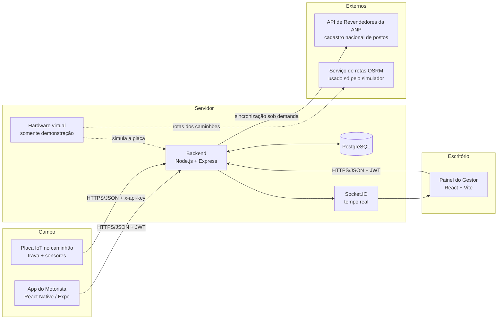
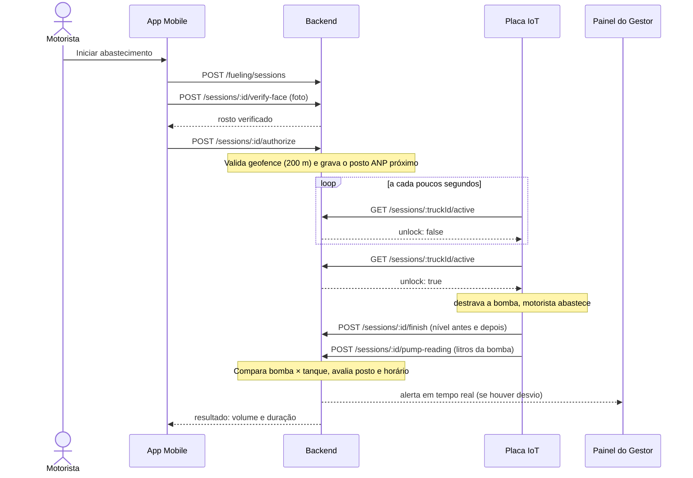
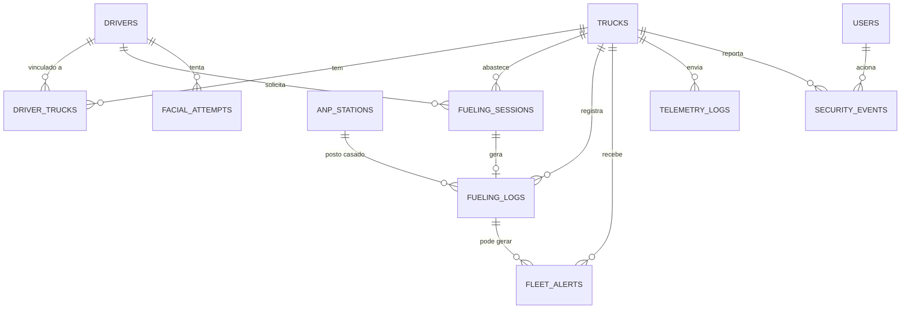

# Arquitetura do Sistema — EHR Solutions

> **Resumo em uma frase:** um app para o motorista, um painel web para o gestor e um backend que só libera a bomba de combustível depois de validar o rosto do motorista, e que cruza os dados da bomba, do tanque e do posto para detectar desvios.
>
> Este documento descreve o que **existe e foi verificado no código**. O que depende do hardware real ou de fornecedores está na seção 10 (limitações) e na seção 11 (próximos passos).

---

## 1. O problema e a solução

Frotas perdem combustível por desvio: abastecimento fora do posto, litros que saem da bomba e não chegam ao tanque, uso indevido do cartão, abastecimento fora de hora. O sistema ataca isso em quatro frentes:

1. **Quem abastece é identificado:** o motorista valida o rosto no app antes de a bomba ser liberada.
2. **A liberação é do servidor, não do motorista:** a placa instalada no caminhão só destrava quando o backend manda.
3. **Os números são cruzados:** litros da bomba × variação do tanque × posto onde o caminhão estava.
4. **O gestor enxerga tudo em tempo real:** mapa, alertas, histórico e auditoria, com papéis e permissões.

---

## 2. Visão geral dos componentes

### Tecnologias

| Camada | Tecnologias |
|---|---|
| **Backend** | Node.js, Express, PostgreSQL (`pg`), Socket.IO, JWT, bcrypt, helmet, cors, express-validator, express-rate-limit, PDFKit e csv-stringify (relatórios), Turf.js (geometria) |
| **Painel web** | React 18, Vite, React Router, Zustand (estado), Axios, Socket.IO client, React Leaflet (mapas), Recharts (gráficos), Lucide (ícones) |
| **App do motorista** | React Native com Expo, React Navigation, expo-camera, expo-image-manipulator, expo-secure-store, expo-location |
| **Qualidade** | Jest (backend e app), Vitest + Testing Library (painel), GitHub Actions (3 jobs), proteção da branch `main` |

---

## 3. Fluxo principal: um abastecimento

**Se o rosto falha 3 vezes**, o app mostra "aguardando o gestor liberar manualmente" e o gestor decide, no painel, com a **Liberação de Emergência** (com motivo registrado). **Se o motorista cancela ou a sessão expira (30 min)**, a próxima consulta da placa devolve `unlock: false` e ela volta a travar.

---

## 4. Papéis e permissões (RBAC)

| Ator | Autenticação | O que pode |
|---|---|---|
| **Admin** | JWT | Tudo, inclusive gerenciar usuários |
| **Gestor (manager)** | JWT | Frota, motoristas, abastecimentos, alertas, liberação de emergência, chave do hardware |
| **Auditor** | JWT | Somente leitura; não altera nada |
| **Motorista** | JWT próprio | Só o próprio abastecimento e o próprio histórico |
| **Placa (hardware)** | `x-api-key` por caminhão | Só age sobre o próprio caminhão |

O painel valida o papel do usuário **no banco a cada requisição**, então desativar um usuário ou trocar o papel vale na hora.

---

## 5. Segurança em camadas

| Camada | O que existe |
|---|---|
| **Acesso** | JWT com expiração; senhas com bcrypt; bloqueio de login por IP (10 tentativas em 15 min); motorista desativado perde o acesso imediatamente |
| **Entrada** | Validação com express-validator em todas as rotas de escrita; consultas parametrizadas; limite de tamanho de imagem e de corpo |
| **Respostas** | Listas fixas de campos (sem `SELECT *` nas respostas); testes de vazamento que varrem chaves e valores em busca de dados internos |
| **Hardware** | Chave de API por caminhão, guardada **só como hash SHA-256** (um *trigger* do banco converte qualquer chave gravada); a chave é gerada no painel, exibida uma única vez, e pode ser trocada ou revogada; limite de falhas de `x-api-key` por IP (`HARDWARE_AUTH_MAX_FAILURES`) e limite independente por dispositivo (`HARDWARE_RATE_LIMIT_PER_MIN`) |
| **Sessão de abastecimento** | Curta (30 min), cancelável, com geofence de 200 m na autorização |
| **Biometria** | Limite de 3 tentativas por sessão e 10 por hora; apenas metadados das tentativas, apagados após 90 dias |
| **Rede** | `helmet`, CORS configurável (`CORS_ORIGINS`), `TRUST_PROXY` configurável para proxy reverso/CDN, limite geral de 150 requisições por minuto por IP |
| **Dados simulados** | O simulador grava `data_source = simulated` e **nunca gera alerta de furto real**; o servidor recusa subir em produção com simulador ou rosto de teste ligados |

### LGPD e dados biométricos

- A imagem enviada em cada verificação **não é gravada em disco**.
- A **foto de referência do motorista** (`drivers.face_photo`) fica no banco, para o gestor ver no cadastro. Ela é gravada **uma única vez** (no cadastro real pelo gestor ou na primeira verificação com câmera real) e nunca é sobrescrita por verificações seguintes.
- O consentimento biométrico fica registrado (`face_consent_at` e versão). O cadastro automático de rosto para testes é recusado fora de desenvolvimento.
- A localização só é usada **no momento do abastecimento**, e não para rastrear a rota completa do motorista.

---

## 6. Detecção de fraude e alertas

| Regra | Como detecta |
|---|---|
| **Divergência** (`fuel_divergence`) | Litros medidos na bomba × variação do nível do tanque, acima do limite configurável no painel |
| **Queda suspeita** (`suspicious_fuel_drop`) | Queda brusca de nível com o veículo parado |
| **Fora de horário** (`fueling_off_hours`) | Abastecimento fora da janela configurada |
| **Posto não reconhecido** (`unrecognized_station`) | A posição do caminhão no abastecimento não tem nenhum posto autorizado da ANP num raio de 150 m |
| **Posto não autorizado** (`unauthorized_station`) | O posto está marcado como não autorizado ou interditado |
| **Tentativa não autorizada** (`unauthorized_fueling_attempt`) | Tentativa de liberação fora das regras (ex.: fora do geofence) |
| **Divergência de GPS app × caminhão** (`security_gps_position_divergence`) | A posição GPS enviada pelo celular no momento da autorização diverge acima do limite (`GPS_DIVERGENCE_KM`, padrão 500 m) da posição do caminhão |
| **Eventos de segurança da placa** (`security_alert`) | Violação (`tamper`), movimento sem sessão, botão de emergência, sinal de furto |

O casamento com o **cadastro nacional da ANP** usa a API oficial de Revendedores (45.762 postos sincronizados em outubro/2026), com caixa de busca pelas coordenadas e raio configurável (`STATION_MATCH_RADIUS_M`, 30 a 1000 m).

---

## 7. Dados

Tabelas: `users`, `drivers`, `trucks`, `driver_trucks`, `fueling_sessions`, `fueling_logs`, `fleet_alerts`, `telemetry_logs`, `security_events`, `facial_attempts`, `fuel_stations`, `anp_stations`, `anp_sync_runs`, `alert_settings`, `alert_settings_history`, `unloading_events` e a tabela de controle das migrations (17 migrations versionadas, com checksum).

---

## 8. Modo demonstração × produção

| Variável | Demonstração | Produção |
|---|---|---|
| `FACE_PROVIDER` | `mock` | provedor real (ainda não implementado) |
| `FACE_MOCK_MODE` | `always_match` (qualquer foto passa) ou `marker` (todas falham) | proibido |
| `VIRTUAL_HARDWARE_ENABLED` | `true` (simula bomba e trava) | `false` (o servidor recusa subir com `true`) |
| `DATA_SOURCE` | `mock` (caminhões se movem no mapa) | `real` (telemetria do hardware físico) |
| `CORS_ORIGINS` | vazio (libera tudo) | lista de origens permitidas |
| `TRUST_PROXY` | vazio ou `1` (túnel HTTPS) | configurado conforme proxy reverso/CDN |
| `JWT_SECRET` | qualquer valor | segredo forte e único |

---

## 9. Qualidade e processo

- **Testes automatizados:** backend com **265+ testes**, painel com **45** e app com **150** (todos executados a cada PR).
- **Testes de contrato:** a documentação da API (`docs/API_MOBILE.md`) é comparada com o código; uma rota ou erro sem documentação derruba o CI.
- **Testes de vazamento:** varrem recursivamente as respostas atrás de campos e valores internos (chaves, hashes, dados da bomba).
- **CI (GitHub Actions):** três jobs (`backend`, `frontend`, `mobile`) em Node 20, com PostgreSQL de verdade; a `main` só recebe merge com os três verdes.
- **Revisão por relatório:** cada entrega tem um relatório em `docs/historico/` com a tabela de itens, provas e pendências.

---

## 10. Limitações conhecidas (e o que falta)

1. **Reconhecimento facial real:** só o modo de teste (`mock`) está implementado. O provedor real com **prova de vida** (liveness) depende de contratação.
2. **Hardware real e Bluetooth:** o fluxo está pronto no servidor e documentado em `docs/GUIA_INTEGRACAO_HARDWARE.md`, mas depende da placa e do protocolo Bluetooth definidos pelo fornecedor. O simulador faz o papel da placa nos testes.
3. **JWT no `localStorage` do navegador:** aceito para o escopo acadêmico; para produção pública, o recomendado é cookie `httpOnly`.
4. **Dependência externa do simulador:** o simulador de frota usa o serviço público OSRM para traçar rotas.
5. **CNPJ do posto vindo da placa:** hoje o posto é identificado pela posição (GPS). A identificação direta pelo CNPJ depende de a placa saber em que posto está.

## 11. Próximos passos sugeridos

- Contratar o provedor facial com prova de vida e substituir o `mock`.
- Integrar a placa real seguindo o guia (`docs/GUIA_INTEGRACAO_HARDWARE.md`), com o fornecedor.
- Cookies `httpOnly` e HTTPS de ponta a ponta no ambiente de produção.
